<p align="center">
  
</p>

I build the parts of a product that have to be right: the money, the permissions, and the message that arrives on time.

I'm an Associate Software Engineer at **Devsinc**, working on **BB Edu**, a two-sided marketplace that staffs educators and has 2,000+ active users. React and Next.js on the front, TypeScript and Supabase Edge Functions in the middle, PostgreSQL underneath.

| | |
|---|---|
| **Based in** | Islamabad, Pakistan |
| **Working on** | Wallets, billing, payroll and notifications on a live marketplace |
| **Learning** | System design, GenAI, microservices, and beginner Japanese |
| **Studied** | BS in Computer Science, COMSATS University Islamabad (CGPA 3.61) |
| **Off the clock** | Story-based games, CS2 and FIFA |

## Follow one request

A teacher taps "Claim shift". This is what happens next, and which part I built.

| Hop | What I built | Result |
|---|---|---|
| **Client** | Next.js and React Native (Expo) apps on one product | Features owned from ticket to release |
| **Edge function** | Supabase Edge Functions in TypeScript, plus webhook pipelines for Twilio SMS, Resend email and Expo push | Claim latency down about 30%, 5+ hours of manual work a week removed by cron jobs |
| **Postgres** | Wallet and billing services with transaction locks, indexed PL/pgSQL procedures, Row-Level Security on 20+ views and tables | 35–50% faster on feeds with 10,000+ records, no double spending |
| **Side effects** | Payroll and invoicing with seniority tiers, surge multipliers and weekly ledger exports | 85%+ test coverage, automated CI/CD |

<details>
<summary><b>Run the failure: two requests, one budget</b></summary>

<br>

Two requests each try to spend 70 from a budget of 100. This is an invented example, not code from my work.

```sql
BEGIN;
-- the second request waits on this line until the first one commits
SELECT balance FROM wallets WHERE id = $1 FOR UPDATE;

UPDATE wallets
SET balance = balance - 70
WHERE id = $1 AND balance >= 70;
COMMIT;
```

Without `FOR UPDATE`, both requests read a balance of 100, both pass the check, and 140 gets spent. With it, the second request waits, sees the real balance of 30, and is rejected.

</details>

## Public work

| Project | What it is | Built with |
|---|---|---|
| [**Secure Nest**](https://github.com/Ash4477/fyp_web) | Smart residential community platform: [admin dashboard](https://fyp-web-nine-ochre.vercel.app) with 12+ modules, [Flutter app](https://github.com/Ash4477/fyp_mobile) and [backend](https://github.com/Ash4477/fyp_backend). My final year project. | Next.js 15, React 19, TypeScript, Flutter, Express, Socket.IO, AWS |
| [**Multivendor e-commerce**](https://github.com/Ash4477/multivendor-ecomm-proj) | Marketplace with admin, vendor and customer roles, real-time orders and chat, Stripe and PayPal. Deploys to EC2 through GitHub Actions. | React, Vite, Express, MongoDB, Socket.IO, Docker |
| [**Log Analyzer**](https://github.com/Ash4477/log-analyzer) | A streaming CLI parser for huge log files and a dashboard for the results. | TypeScript, Node.js, React, Recharts, Vitest |
| [**Scholar App backend**](https://github.com/Faze789/scholar_app) | Flask API that predicts admissions for 9 Pakistani universities and matches scholarships. A collaboration. | Python, Flask, scikit-learn, TensorFlow |
| [**Bytewise Fellowship**](https://github.com/Ash4477/bytewise-fellowship) | Everything from the MERN track, where I finished as a Bronze Fellow. | JavaScript, MERN |
| [**15 Days of LeetCode**](https://github.com/Ash4477/15-Days-Of-Leetcode-Challenge) | Java solutions, one folder per problem. 100+ problems solved overall. | Java |

The rest of my repositories, from Java games to The Odin Project coursework, are on my [repositories page](https://github.com/Ash4477?tab=repositories).

## Toolbox

| | |
|---|---|
| **Languages** | TypeScript, JavaScript, Python, Java, Dart, C++ |
| **Frontend** | React, Next.js, React Native, Expo, Redux, TanStack Query, Tailwind CSS, Flutter |
| **Backend and data** | Node.js, Express, Socket.IO, Supabase, PostgreSQL, MongoDB, MySQL, Firebase |
| **Cloud and DevOps** | AWS, Docker, GitHub Actions, Kubernetes, Jenkins, Vercel |
| **Testing and tools** | Jest, Vitest, React Testing Library, Deno, Sentry, PostHog, Stripe, Twilio, Resend |

## Elsewhere

[LinkedIn](https://www.linkedin.com/in/adil-feroze-242a99253/) · [itch.io](https://itch.io/profile/adil-feroze) · [Instagram](https://www.instagram.com/adil_feroze/) · [LeetCode](https://leetcode.com/u/adilferoze321/)
